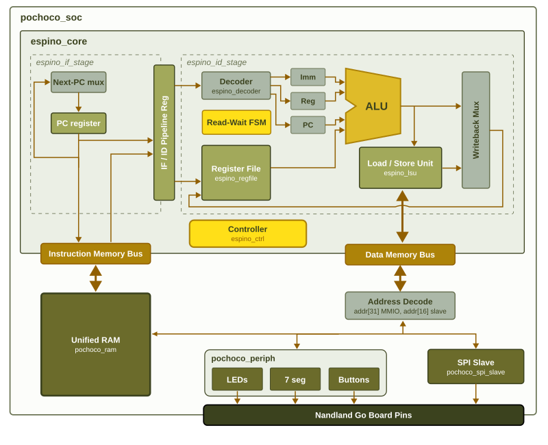

# Proyecto 3: del RTL de FPGA a un macro ASIC (GF180MCU + LibreLane)

Este repositorio parte del Proyecto 2 (juego de reflejos sobre el Pochoco SoC) y lo
lleva de RTL a GDSII con LibreLane y el PDK GF180MCU. El mismo RTL sigue
funcionando en la Go Board: las partes propias de cada tecnologia estan separadas.

## Versiones de la corrida final

| Herramienta | Version |
|---|---|
| LibreLane | 3.0.16 (`git checkout 3.0.16`, entorno `nix-shell`) |
| PDK | gf180mcuD, revision `54435919abffb937387ec956209f9cf5fd2dfbee` (2025.12.26, instalado por ciel) |
| Biblioteca de celdas | gf180mcu_fd_sc_mcu7t5v0 |
| Yosys | 0.62 (git sha1 7326bb7d6641500ecb285c291a54a662cb1e76cf) |
| OpenROAD | dcf36133a369abc8f3c5e5738cd4d82e4903c0e0 |
| Magic | 8.3.623 |
| Netgen | 1.5.316 |
| KLayout | 0.30.7 |
| Verilator | 5.044 |

Se obtienen con `bash asic/scripts/versions.sh` dentro de `nix-shell`.

## Resultados principales

| Corrida | Die | Celdas | FFs | Setup WS lento | Hold WS lento | DRC / LVS / Antena |
|---|---|---|---|---|---|---|
| **Estrategia A, final** (T = 100 ns, U = 40 %) | 0,444 mm² | 213.569 µm² | 1.070 | +35,3 ns | +1,00 ns | 0 / 0 / 0 |
| Estrategia B (`final_v3`) | 2,252 mm² | 1.347.150 µm² | 5.967 | +11,3 ns | +0,82 ns | 0 / 0 / 0 |
| A optimizada (decoder registrado), T = 100 ns | 0,459 mm² | 221.256 µm² | | +41,1 ns | +0,98 ns | 0 / 0 / 0 |

* Periodo minimo: A = 65 ns (15,4 MHz); A optimizada = 60 ns (16,7 MHz).
* Area minima que completa el flujo: FP_CORE_UTIL = 62 % (die 0,291 mm²); con 70 % el ruteo detallado no converge.
* Simulacion post-sintesis (A): ciclos medidos y salidas identicas al RTL.

## Estructura

```text
rtl/common/        RTL independiente de la tecnologia (core Espino, SoC, perifericos,
                   contador de ciclos en su propio modulo, SPI)
rtl/fpga/          solo FPGA: game_top.v (power-on reset, display activo en bajo),
                   banco de registros con SB_RAM40_4K, memoria BRAM con $readmemh
rtl/asic/          solo ASIC: asic_top.v, sincronizador de reset, banco de registros
                   con flip-flops, memoria estrategia A (ROM + RAM) y B (FF unificada)
rtl/asic/gen/      GENERADO por el assembler: ROM del juego e init de la memoria (10 MHz)
sim/asic/          testbench del macro (RTL y netlist), estimulos y programa de simulacion
asic/strategy_A/   config de LibreLane, estrategia A (corrida final)
asic/strategy_A_opt/ estrategia A + decoder registrado (optimizacion de la ruta critica)
asic/strategy_B/   config de LibreLane, estrategia B
asic/sim_A, sim_B/ sintesis con el programa de simulacion (para 3.7)
asic/p2_original/  experimentos con el RTL del Proyecto 2 sin cambios (evidencia de 3.1)
asic/scripts/      barridos, metricas, area por modulo, ruta critica, layout anotado
tools/rvasm.py     assembler (ahora tambien genera la ROM y el init de la memoria)
```

## Instalacion de LibreLane (Windows con WSL2 + Nix)

1. En PowerShell: `wsl --install -d Ubuntu` y reiniciar. Abrir "Ubuntu" desde Inicio.
2. En Ubuntu:

```bash
sudo apt-get install -y curl git make python3 iverilog
curl --proto '=https' --tlsv1.2 -fsSL https://artifacts.nixos.org/nix-installer | sh -s -- install --no-confirm --extra-conf "
    extra-substituters = https://nix-cache.fossi-foundation.org
    extra-trusted-public-keys = nix-cache.fossi-foundation.org:3+K59iFwXqKsL7BNu6Guy0v+uTlwsxYQxjspXzqLYQs=
    extra-experimental-features = nix-command flakes
"
```

3. Cerrar y abrir la terminal de Ubuntu. Luego:

```bash
git clone https://github.com/librelane/librelane
cd librelane && git checkout 3.0.16
nix-shell                      # la primera vez descarga varios GB (~10 min)
librelane --smoke-test         # prueba la instalacion y baja el PDK gf180mcu
```

4. Clonar este repositorio DENTRO de Ubuntu (por ejemplo `~/proyecto3`), no en
   `/mnt/c/...`: el disco de Windows es mucho mas lento desde WSL.

Cada vez que se trabaje: `cd ~/librelane && nix-shell`, y luego `cd ~/proyecto3`.

La estrategia B necesita mas memoria de la que WSL entrega por defecto. Crear
`C:\Users\<usuario>\.wslconfig` con `[wsl2]`, `memory=5GB` y `swap=8GB`, ejecutar
`wsl --shutdown` y correr B con `--jobs 2`.

## Regenerar el programa desde game.s

```bash
make asic-gen PYTHON=python3
```

Ensambla `sw/game.s` con `CLK_HZ=10000000` (periodo T = 100 ns) y genera:

* `rtl/asic/gen/game_rom.v`: ROM combinacional de la estrategia A,
* `rtl/asic/gen/game_mem.vh`: tamanos y contenido inicial de la estrategia B,
* `sim/asic/gen/*`: lo mismo con `CLK_HZ=20000`, para simular.

Equivale a `python3 tools/rvasm.py sw/game.s -D CLK_HZ=10000000 --rom-v ... --mem-vh ... --report`.

## Corrida final

```bash
librelane --pdk gf180mcuD --run-tag final asic/strategy_A/config.yaml   # o: make asic-A
librelane --pdk gf180mcuD --jobs 2 --run-tag final_v3 asic/strategy_B/config.yaml   # B: --jobs 2 limita la RAM
python3 asic/scripts/metrics.py asic/strategy_A/runs/final  # resumen
librelane --pdk gf180mcuD --last-run --flow OpenInKLayout asic/strategy_A/config.yaml   # ver el layout
```

## Mapa de la entrega

| Seccion | Comando | Donde quedan los datos |
|---|---|---|
| 3.1 | `librelane --pdk gf180mcuD asic/p2_original/config.yaml --to Yosys.Synthesis` | `runs/*/*-verilator-lint/*.log`, `*-yosys-synthesis/*.log` |
| 3.2 | `make asic-A`, `make asic-B` | `python3 asic/scripts/metrics.py asic/strategy_*/runs/final` |
| 3.3 | `python3 asic/scripts/area_by_module.py asic/strategy_A/runs/final` | `*-yosys-synthesis/reports/stat.rpt`, `runs/final/area_by_module.rpt` |
| 3.4 | `python3 asic/scripts/sweep.py asic/strategy_A/config.yaml CLOCK_PERIOD 100 50 35 25` | `asic/strategy_A/sweep_CLOCK_PERIOD.csv` |
| 3.4 | `python3 asic/scripts/crit_path.py asic/strategy_A/runs/final` | ruta critica con modulos |
| 3.5 | `python3 asic/scripts/sweep.py asic/strategy_A/config.yaml FP_CORE_UTIL 40 55 70 85` | `sweep_FP_CORE_UTIL.csv` + `plot_sweep.py` |
| 3.6 | `python3 asic/scripts/highlight_layout.py asic/strategy_A/runs/final` | `runs/final/layout_anotado.png` |
| 3.7 | `asic/scripts/sim.sh rtl A`; `librelane --pdk gf180mcuD --run-tag synth asic/sim_A/config.yaml --to Yosys.Synthesis`; `asic/scripts/sim.sh gl A asic/sim_A/runs/synth/*-yosys-synthesis/asic_top.nl.v` | `sim/asic/out/` |


---

# Proyecto 2: Juego de reflejos

Para el Proyecto 2 se implementó un juego de reflejos utilizando Espino Core y los periféricos disponibles en la Go Board.

El programa principal del juego se encuentra en:

```text
sw/game.s
```

## Comandos principales

| Comando | Función |
|---|---|
| `make hex` | Ensambla `sw/game.s` y genera `sw/game.hex` y `sw/game.lst` |
| `make` | Genera el programa, sintetiza el hardware y programa la Go Board |
| `make bin` | Realiza el proceso de compilación sin programar la FPGA |
| `make sim` | Simula una partida utilizando Icarus Verilog |
| `make test` | Ejecuta las pruebas del assembler |

También se puede generar el archivo `.hex` manualmente utilizando:

```bash
python3 tools/rvasm.py sw/game.s -o sw/game.hex -l sw/game.lst
```

Algunas constantes del programa pueden modificarse desde la línea de comandos sin cambiar directamente el archivo Assembly.

Por ejemplo, para cambiar el tiempo inicial:

```bash
python3 tools/rvasm.py sw/game.s -o sw/game.hex -D ALL_ON_TIME=100000000
make
```

## Cómo se juega

Al encender el sistema, los LEDs realizan una secuencia en carrusel.

Para comenzar una partida se debe presionar cualquiera de los botones.

Cada ronda funciona de la siguiente manera:

1. Los cuatro LEDs se encienden durante aproximadamente 3 segundos.
2. Después queda encendido solamente uno de los LEDs.
3. El jugador debe presionar el botón correspondiente a ese LED.
4. El tiempo de respuesta se muestra en los displays en décimas de segundo.
5. Si se presiona el botón incorrecto, los displays muestran `EE`.
6. Los LEDs parpadean para indicar el error.
7. La ronda se repite hasta obtener una respuesta correcta.
8. Las respuestas correctas anteriores se mantienen.
9. Después de 10 respuestas correctas se calcula el tiempo promedio.
10. El promedio se muestra en los displays.
11. Los LEDs alternan entre `0101` y `1010`.
12. Al presionar nuevamente un botón comienza una nueva partida.

El tiempo máximo mostrado es:

```text
9.9 segundos
```

que aparece en el display como:

```text
99
```

## Cambios realizados al RTL

Para implementar el juego se realizaron algunos cambios y se agregaron módulos al diseño original.

### `rtl/fpga/game_top.v`

Este archivo corresponde al top-level utilizado para el juego.

El módulo instancia `pochoco_soc` utilizando:

```text
sw/game.hex
```

como programa cargado inicialmente en memoria.

### `rtl/common/pochoco_periph.v` y `rtl/common/pochoco_cycle_counter.v`

En este módulo se agregó:

- Un contador de ciclos de 32 bits
- Un sincronizador de dos flip-flops para las entradas de los botones

El contador de ciclos se encuentra mapeado en la dirección:

```text
0x8000_000C
```

La FPGA utiliza un reloj de:

```text
25 MHz
```

Por lo tanto:

```text
1 décima de segundo = 2.500.000 ciclos
```

Este contador se utiliza para medir el tiempo de reacción del jugador durante cada ronda.

---

# Pochoco SoC & Espino Core

Este repositorio contiene el diseño de un procesador de 32 bits y un System-on-Chip (SoC) implementado en Verilog para ser utilizado en una FPGA.

El proyecto está pensado para trabajar conceptos de Arquitectura de Computadores, como ejecución de instrucciones, memoria, periféricos, registros y comunicación entre distintos módulos del sistema.



## Estructura del proyecto

El diseño está dividido principalmente en dos partes: Espino Core y Pochoco SoC.

### Espino Core

Espino Core corresponde al procesador del sistema. Incluye los módulos principales necesarios para ejecutar instrucciones:

- Instruction Fetch
- Instruction Decode
- ALU
- Banco de registros
- Load/Store Unit
- Control del pipeline

El procesador implementa [RV32E](https://docs.riscv.org/reference/isa/v20260120/unpriv/rv32.html).

Actualmente las instrucciones de shift (`SLL`, `SRL`, `SRA`, `SLLI`, `SRLI` y `SRAI`) son decodificadas, pero no están implementadas en la ALU para disminuir el uso de LUTs en la FPGA.

Por este motivo, estas instrucciones deben evitarse en los programas Assembly utilizados actualmente.

### Pochoco SoC

Pochoco SoC es el módulo principal que conecta el procesador con el resto del sistema.

Incluye:

- Memoria RAM compartida para instrucciones y datos
- LEDs de la placa
- Botones
- Displays de 7 segmentos
- Interfaz SPI
- Periféricos mapeados en memoria

## Mapa de memoria

El sistema utiliza distintas direcciones para acceder a la memoria y a los periféricos.

### RAM

Dirección base:

```text
0x0000_0000
```

Esta memoria se utiliza tanto para instrucciones como para datos.

### Periféricos de la placa

Dirección base:

```text
0x8000_0000
```

Offsets disponibles:

| Offset | Periférico |
|---|---|
| `0x00` | Displays de 7 segmentos |
| `0x04` | LEDs |
| `0x08` | Botones |
| `0x0C` | Contador de ciclos |

### SPI

Dirección base:

```text
0x8001_0000
```

Offsets:

| Offset | Función |
|---|---|
| `0x00` | Estado SPI |
| `0x04` | Byte recibido |
| `0x08` | Byte enviado por el procesador |

## Compilación

Para compilar el proyecto es necesario tener instalado el toolchain para FPGA.

Se puede utilizar OSS CAD Suite:

https://github.com/YosysHQ/oss-cad-suite-build

Una vez instaladas las herramientas, desde la carpeta principal del proyecto se puede ejecutar:

```bash
make all
```

Este comando realiza la síntesis, place & route, genera el bitstream y programa la FPGA.

También se puede utilizar:

```bash
make bin
```

para generar el bitstream sin programar la placa.

## Software

La carpeta:

```text
sw/
```

contiene los programas en Assembly que se ejecutan en Espino Core.

Algunos ejemplos son:

```text
blink.s
7seg.s
buttons_leds.s
game.s
```

Estos archivos son ensamblados y convertidos a archivos `.hex`, que posteriormente son cargados en memoria mediante `$readmemh`.

Para compilar uno de los programas se puede utilizar:

```bash
cd sw
make blink
```

Esto genera el archivo:

```text
blink.hex
```

Si el toolchain instalado utiliza un prefijo diferente, este se puede indicar directamente al ejecutar `make`.

Por ejemplo:

```bash
make PREFIX=riscv64-elf- blink
```

También es posible agregar nuevos programas.

Si se crea un archivo:

```text
programa.s
```

se puede compilar con:

```bash
make programa
```

sin necesidad de modificar el `Makefile`.

Al cambiar el programa que se quiere ejecutar también se debe verificar el parámetro `MemFile` utilizado por el SoC.

---

